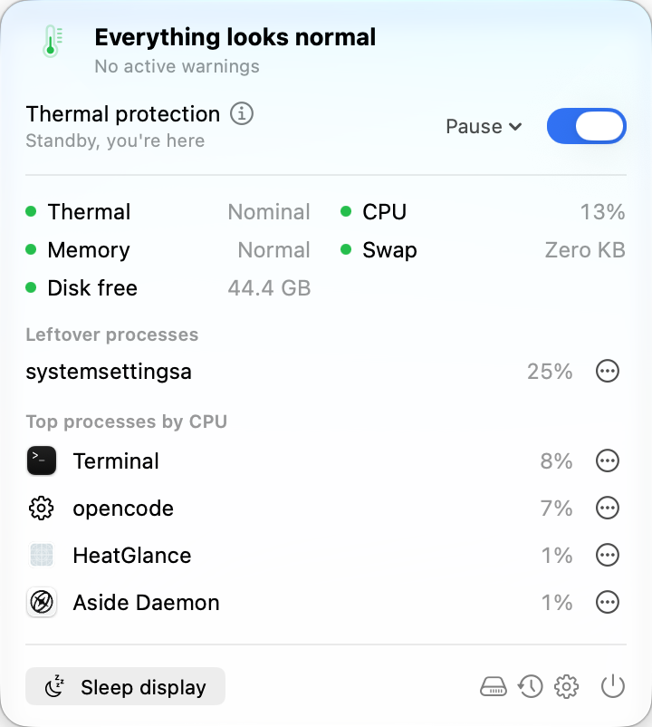

# HeatGlance

A menu bar app for Apple silicon Macs. It watches heat, memory, CPU and disk, tells you what is going on, and puts the fix one click away.



The icon is a thermometer that climbs as the Mac works harder: low, medium, high. Click it when the fans spin up or everything feels slow, and you get the numbers, the app behind them and the buttons to act. HeatGlance lives only in the menu bar, with no Dock icon and no main window.

## The panel

The header names the worst thing happening right now: everything looks normal, something needs attention, or under pressure. Below it, each active warning carries the number that triggered it, for example CPU at 96%, and a button when one helps.

| Metric | What it shows |
| --- | --- |
| Thermal | macOS thermal pressure and the hottest die sensor, in °C, when it can be read |
| CPU | System-wide CPU load |
| Memory | macOS memory pressure, with the biggest consumer named in the warning |
| Swap | Swap in use, which grows when memory runs short |
| Disk free | Free space in gigabytes |

Then comes the list of apps:

- the four apps using the most CPU, grouped by app, each with a menu for Suspend, Quit and Ignore for an hour;
- apps paused by the protection, with Resume and Resume all;
- leftover processes, helpers still running after their app quit.

The footer holds Sleep display, Cleanup, History, Settings and Quit.

## Warnings that hold, then clear

A warning shows up only after the condition lasts: a minute of serious thermal pressure, two minutes of CPU at 90% or more, five minutes of growing swap. It goes away when the condition does. Once a warning has produced a notification, the next one for the same condition waits fifteen minutes, so a long burst does not turn into a stream of alerts.

Default thresholds, all adjustable in Settings:

- serious thermal pressure lasting 60 seconds
- system CPU over 90% for 2 minutes
- one app over 150% CPU for 2 minutes
- swap over 25% of physical memory for 5 minutes
- less than 20 GB free on disk

## Knows the usual suspects

A bundled list explains the processes people blame most: Spotlight indexing, kernel_task, Docker, Chrome helpers, Xcode builds and others. For each one HeatGlance says what it does, whether the load is normal, and whether stopping it is wise. When the app is one of those, the row says that waiting is usually better.

## Thermal protection

While you are away, HeatGlance can pause the apps that make the Mac hot, then resume them once it cools down. It reads presence from the lock screen, display sleep, session changes and idle time; a video, a call or a presentation counts as you being present. The feature is on by default. You can pause it for an hour or until tomorrow, turn it off, or keep a list of apps it must never pause.

Two safety rules: only whole apps with a bundle identifier are paused, never bare processes, and every pause is written down before it happens and undone on the next launch, so a crash cannot leave an app frozen.

## Freeing space

The Cleanup window measures a short list of known caches and empties them on request:

- Xcode DerivedData, iOS DeviceSupport and simulators whose runtime is gone;
- Homebrew downloads, the npm cache, the pnpm store and unused Docker images;
- Time Machine local snapshots, listed for reference. Deleting them needs administrator rights that HeatGlance does not ask for yet.

Only the folders in that list are touched. Sizes are measured before you clean, so you know what you are about to free.

HeatGlance also scans a few folders for files larger than 1 GB, every 30 minutes, and warns when a watched folder grows by several gigabytes. This works inside Desktop, Documents, Downloads, Pictures, Movies, Music and the Library caches only after you grant full disk access.

## History

The History window has a 24 hour chart of CPU with the worst process of each minute, and a weekly report with minutes spent in serious thermal pressure, protection interventions, and the apps that used the most CPU, memory and disk writes, plus how much each one changed from the week before.

A weekly summary notification is available in Settings, off by default.

## Settings

- Launch at login.
- Sampling every 2 seconds, or every 5 seconds on power and 10 seconds on battery.
- Alert thresholds for thermal, CPU, swap and disk.
- Thermal protection: trigger level, sustain time, presence signals, never-pause list.
- Ignored items, the large file threshold and the weekly summary.

## What it never does

- It takes no action on its own, except thermal protection, which you can pause or switch off.
- It uses no privileged helper, no Apple Events and no Accessibility access.
- It sends nothing anywhere. There is no network code, and every setting and history file stays on the Mac.

## Requirements

- macOS 14 or later
- Apple silicon
- Xcode 16 or later, with XcodeGen (`brew install xcodegen`)

## Build and run

```bash
./build.sh          # Debug build into build/
./run.sh            # build, then open the app
./test.sh           # package tests, then check the project generates
./release.sh        # Developer ID build, notarized DMG into dist/
```

## Permissions

- Notifications, for the alerts. Nothing is sent anywhere.
- Full disk access, optional, to measure folders and scan files inside protected folders.
- No other permissions are requested.

## License

MIT, see `LICENSE`.
